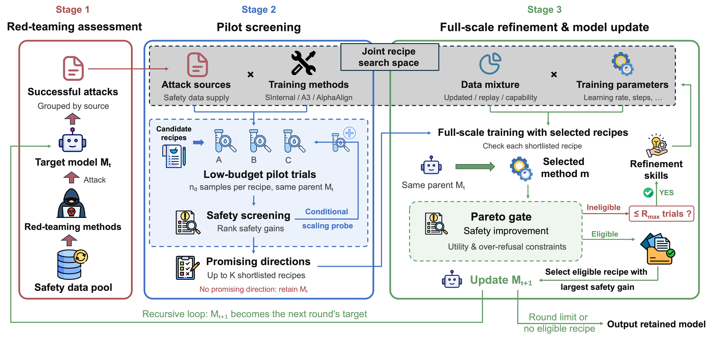

# ReSI: Recursive Safety Improvement Toward Resistant and Resilient AI



ReSI strengthens resistance to identified attacks and resilience to unseen risks through recursive safety improvement driven by automated research. In each round, ReSI develops and evaluates training recipes, then selects the checkpoint with the largest safety gain under benign-compliance and instruction-following constraints. The selected model becomes the next round's target; if none qualifies, ReSI retains the current model.

[Paper](https://arxiv.org/abs/2610.12233) · [Models on Hugging Face](https://huggingface.co/collections/AI45Research/resi)

## Installation

Requires Linux, an NVIDIA GPU with a compatible CUDA driver, and Python 3.12.

```bash
git clone https://github.com/AI45Lab/ReSI.git
cd ReSI
R2AI_SETUP_PYTHON=python3.12 bash scripts/setup.sh full
```

For distributed training and the local evaluation service, see [model backends](docs/model_backends.md).

## Configuration

Set model and data paths, API services, training parameters, search limits, and evaluation settings in **[config.json](config.json)**. Supply API keys through the configured environment variables.

Details: [parameter reference](docs/research_configuration.md) · [data preparation](docs/data_interface.md).

## Usage

Run the search (up to three rounds by default), then evaluate the retained checkpoint separately:

```bash
bash scripts/run.sh --config config.json
bash scripts/evaluate_full.sh --config config.json --run runs/research
```

Evaluation produces `summary.json`, `metrics.csv`, and per-example results; see the [evaluation guide](docs/formal_evaluation.md).

## License

[MIT](LICENSE). Dependencies, datasets, and model weights retain their respective licenses.
